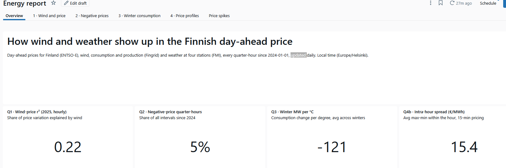
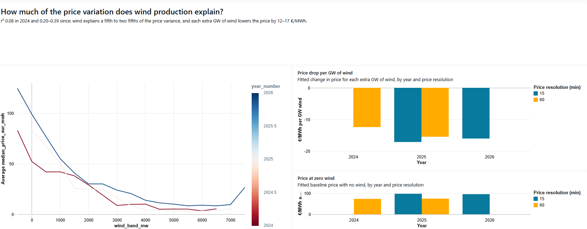
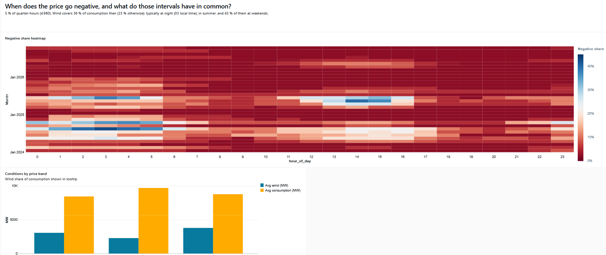
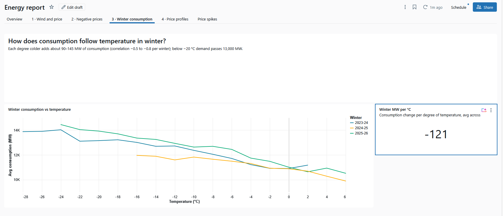
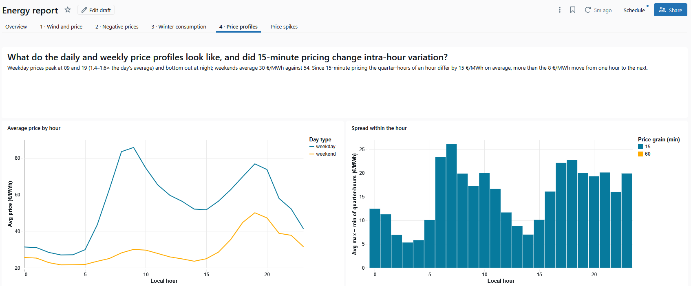
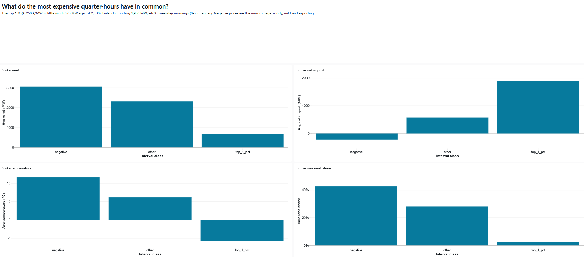
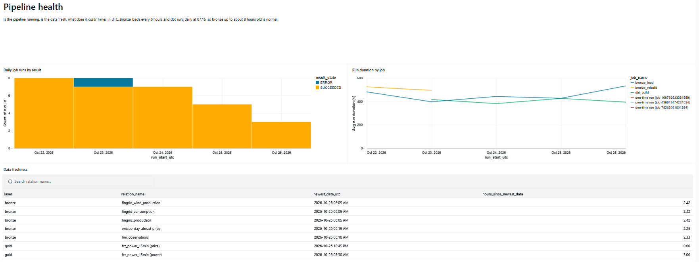
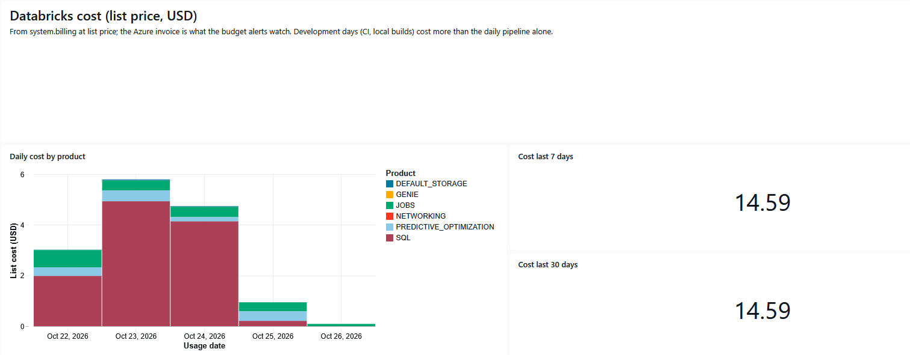

# Energy data platform

[](https://github.com/jtnOranen/energy-data-platform/actions/workflows/ci.yml)

> How do wind power and weather show up in the Finnish day-ahead electricity price? Strongly: wind
> explains up to two fifths of the price variance, and the most expensive quarter-hours are cold, calm
> weekday mornings when Finland imports.

**The main goal of this project is to train and showcase end-to-end data pipeline utilizing infrastructure-as-a-code, Azure environment and Databricks**. The focus is on the data engineering side of the project rather than on the visualisation and end report.
How wind power and weather show up in the Finnish day-ahead electricity price — an end-to-end data platform on
Azure and Databricks, built with Terraform, dbt and GitHub Actions. Architecture and data flow:
[docs/architecture.md](docs/architecture.md).

## Report

Every quarter-hour since 2024-01-01: day-ahead prices (ENTSO-E), wind, consumption and production
(Fingrid), and weather at four stations (FMI). Updated daily; local time (Europe/Helsinki). The
numbers come from tested dbt models (`dbt/models/reports`), which the Databricks AI/BI dashboard
`Energy report` only displays.

| Question | Finding |
| --- | --- |
| How much of the price variation does wind production explain? | r² 0.08 in 2024 and 0.20–0.39 since: a fifth to two fifths of the variance. Each extra GW of wind lowers the price by 12–17 €/MWh. |
| When does the price go negative, and what do those intervals have in common? | 5 % of quarter-hours. Wind then covers 36 % of consumption (23 % otherwise); typically at night (03 local time), in summer, 43 % of them at weekends. |
| How does consumption follow temperature in winter? | About 90–145 MW more per degree colder (correlation −0.5 to −0.8 per winter); below −20 °C demand passes 13,000 MW. |
| What do the daily and weekly price profiles look like, and did 15-minute pricing change intra-hour variation? | Weekday prices peak at 09 and 19 (1.4–1.6× the daily average); weekends average 30 €/MWh against 54. Since 15-minute pricing (2025-10-01) the quarter-hours of an hour differ by 15 €/MWh on average, more than the 8 €/MWh move from one hour to the next. |
| Price-spike anatomy | The most expensive 1 % (≥ 250 €/MWh) comes with little wind (670 MW against 2,300), 1,900 MW of imports and −6 °C, on weekday mornings in January. Negative prices are the mirror image: windy, mild, exporting. |

Figures as of 2026-10-24.



<details>
<summary>The report's pages, one per question</summary>











</details>

## Monitoring

- **Failures alert by email:** a Databricks job that fails after its retries (or runs past 30 minutes),
  an ingestion function that fails twice in three hours (Azure Monitor), stale data (the daily dbt job's
  `source freshness` fails it), the budget (actual and forecast).
- **Pipeline health dashboard:** job runs, dbt results per run, data freshness per layer and daily
  Databricks cost at list price, from Databricks system tables and the dbt run results the job stores
  (`dbt/models/ops`).
- **Dashboards as code:** both dashboards are files in the Asset Bundle, deployed by CI; a dashboard
  edited in the UI but not in the repository is flagged on PRs and stops the deploy
  ([databricks/README.md](databricks/README.md)).



<details>
<summary>Cost page</summary>



</details>

## Stack

Azure Functions · ADLS Gen2 · Key Vault · Databricks (Unity Catalog, Auto Loader, Workflows, Asset Bundles) ·
dbt · Terraform · GitHub Actions (OIDC)

## Run it yourself

### Bootstrap (once)

```bash
az login
GITHUB_OWNER=<you> ./infra/bootstrap/bootstrap.sh
```

Creates the Terraform state storage, a service principal with OIDC federated credentials and the GitHub repo variables.

### Deploy

Open a pull request: CI runs `fmt`, `validate` and `plan` and posts the plan as a comment. Merging to
`main` applies that plan in the `dev` environment, then runs `plan` once more and fails if it shows any
change, which catches config that never converges.

### Backfill (once, after the first deploy)

```bash
SA=$(az storage account list -g rg-energy-dev --query "[?starts_with(name, 'stenergydev')].name | [0]" -o tsv)
KV=$(az keyvault list -g rg-energy-dev --query "[0].name" -o tsv)
uv run python ingestion/backfill.py --storage-account "$SA" --key-vault "$KV"
```

Loads 2024-01-01 → now for all three sources into `landing` with the same code as the hourly functions.

## Design decisions

See [docs/adr](docs/adr). Highlights: [ingestion](docs/adr/0002-azure-function-for-ingestion.md),
[dbt](docs/adr/0003-dbt-for-transformations.md), [OIDC](docs/adr/0004-oidc-for-ci-authentication.md),
[UTC and 15-minute grain](docs/adr/0005-utc-and-15-minute-grain.md).

## Data quality

- **Bronze** keeps every source field as a string with an explicit schema; anything unexpected lands in
  `_rescued_data` instead of failing the load or being dropped.
- **Staging** tests the natural keys (unique, not null) and asserts what the sources promise: ENTSO-E's
  bidding zone, currency, unit, curve type and resolution, FMI's stations and parameters.
- **Intermediate** has dbt unit tests for the tricky logic (60→15-minute expansion, forward-filling the
  positions ENTSO-E omits, 30-minute Fingrid records, aligning 10-minute weather to quarter-hours) and a
  data test that every delivery period, DST days included, yields one price per quarter-hour.
- **Gold** has enforced model contracts, primary and foreign keys, and a test that every complete UTC day
  has exactly 96 quarter-hours. Source freshness fails the daily job when bronze is over 24 hours old.
- **CI** builds changed models and their tests in a pull-request schema against production data before
  anything merges (slim CI); `main` accepts nothing without green checks.

## Cost

*(actual monthly cost, phase 6)*

## Limitations and next steps

*(phase 6)*

## Data sources and licences

Fingrid open data, ENTSO-E Transparency Platform, Finnish Meteorological Institute open data. See
[docs/data-sources.md](docs/data-sources.md).
