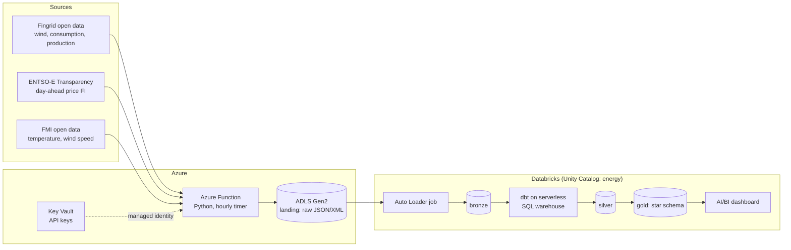

# Architecture

## Goal

Answer, with reproducible data engineering, **how wind power and weather show up in the Finnish day-ahead
electricity price**. Secondary goals: show production-grade practices (IaC, CI/CD, testing, data quality, cost control).

## Data flow

Terraform creates every Azure and Databricks resource. GitHub Actions tests every pull request and deploys `main`.

## Components

| Component | Responsibility | Notes |
| --- | --- | --- |
| Azure Function (`ingestion/`) | Fetch the three APIs and write raw responses to ADLS | Timer trigger hourly; idempotent; overlap window to catch late data |
| ADLS Gen2 `landing` container | Immutable raw files | Path: `landing/<source>/<dataset>/yyyy=YYYY/mm=MM/dd=DD/<ingested_at>_<window_start>_<window_end>[_<key>]_p<part>.<json\|xml>`; date = ingestion date (UTC), `key` = e.g. FMI station |
| Key Vault | Fingrid API key, ENTSO-E token | Function reads via managed identity (RBAC) |
| Databricks Auto Loader job | Raw files → bronze Delta tables | Serverless, `availableNow` run once a day (ADR 0017); explicit schemas with `_rescued_data`; adds `_ingested_at`, `_source_file`, `_loaded_at` |
| dbt (`dbt/`) | bronze → silver → gold | dbt-databricks adapter, serverless SQL warehouse |
| Databricks Workflows | Orchestration: `bronze_load` at 06:30 UTC, `dbt_build` at 07:15 UTC after it | Defined in a Databricks Asset Bundle; dbt task on serverless jobs compute (ADR 0014) |
| AI/BI dashboards | `Energy report` on the gold `rpt_*` models; `Pipeline health` on the `ops_*` views (job runs, dbt results, freshness, cost) | Defined in the bundle (`databricks/resources/dashboards`), deployed by CI; datasets only select from dbt models |
| Monitoring | Failure alerts by email: Databricks job notifications, an Azure Monitor log alert on the functions (2 failures in 3 h), dbt source freshness, budget alerts | Terraform `modules/monitoring`, bundle job settings |
| Terraform (`infra/`) | All infrastructure | Remote state in a separately bootstrapped storage account |
| GitHub Actions (`.github/`) | CI on PR, CD on `main` | One `ci.yml` with a required gate check; OIDC to Azure, no long-lived secrets |

## Environments

One environment, `dev`, to keep cost low. Pull requests that change dbt get their own schemas (`pr_<number>_silver`,
`pr_<number>_gold`) in the same workspace: slim CI builds only the changed models and their dependants there, reading
everything else from production, and the schemas are dropped when the PR closes. Production-like separation is shown
through this pattern, not a second workspace.

## CI/CD

One workflow, `ci.yml`, for every pull request and every push to `main` (ADR 0015). It detects which parts changed and
calls their reusable workflows (Terraform, ingestion, Databricks bundle, dbt); pre-commit and gitleaks run on every PR.
Its gate job, `all checks passed`, is the only required status check on `main`, so nothing merges red and docs-only PRs
aren't blocked by skipped checks. On `main` the deploys run in order: Terraform apply, function deploy, bundle deploy.
Third-party actions are pinned to commit SHAs and kept current by Dependabot.

## Security model

- GitHub Actions → Azure: OIDC federated credentials, no secrets, on two service principals. The deploying one
  (`main` and `environment:dev` credentials) applies Terraform and deploys. Pull requests run as a read-only one
  (`pull_request` credential, ADR 0016): it plans, validates and builds dbt PR schemas, but can't change
  infrastructure or production data. The `dev` environment accepts deployments only from `main`.
- Function → Key Vault and ADLS: system-assigned managed identity with least-privilege RBAC roles.
- Databricks → ADLS: Access Connector (managed identity) + Unity Catalog storage credential and external location.
- No secrets in the repository or in GitHub secrets except where a tool cannot use OIDC (documented in an ADR if so).

## Cost controls

Budget alert in Terraform, serverless jobs compute for the bronze load (ADR 0011), smallest serverless SQL warehouse with
auto-stop, scheduled (not continuous) runs (ingestion hourly, bronze and dbt daily), predictive optimization off (ADR 0017), resource tags `project` and `env` on everything. Actual monthly cost is
recorded in the README.

## Decisions

See `docs/adr/`. Key ones: Azure Function for ingestion (0002), dbt for transformations (0003), OIDC for CI (0004),
UTC and 15-minute grain (0005), serverless jobs for bronze (0011), workspace in bootstrap (0012), serverless workspace (0013), daily dbt job (0014),
one CI entry point with a gate check (0015), read-only identity for pull requests (0016), daily bronze load and no predictive optimization (0017).
