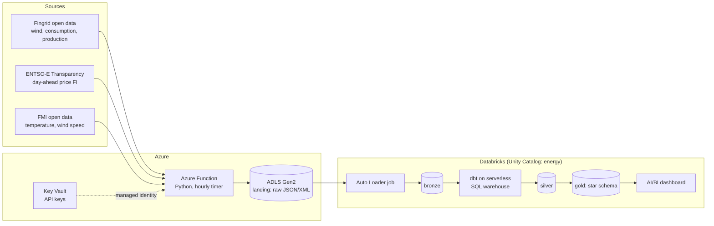

# Architecture

## Goal

Answer, with reproducible data engineering, **how wind power and weather show up in the Finnish day-ahead
electricity price**. Secondary goals: show production-grade practices (IaC, CI/CD, testing, data quality, cost control).

## Data flow

Terraform creates every Azure and Databricks resource. GitHub Actions tests every pull request and deploys `main`.

## Components

| Component | Responsibility | Notes |
| --- | --- | --- |
| Azure Function (`ingestion/`) | Fetch the three APIs and write raw responses to ADLS | Timer trigger hourly; idempotent; overlap window to catch late data |
| ADLS Gen2 `landing` container | Immutable raw files | Path: `landing/<source>/<dataset>/yyyy=YYYY/mm=MM/dd=DD/<ingested_at>_<window_start>_<window_end>[_<key>]_p<part>.<json\|xml>`; date = ingestion date (UTC), `key` = e.g. FMI station |
| Key Vault | Fingrid API key, ENTSO-E token | Function reads via managed identity (RBAC) |
| Databricks Auto Loader job | Raw files → bronze Delta tables | Serverless, hourly `availableNow` run; adds `_ingested_at`, `_source_file`, `_loaded_at`; schema evolution `addNewColumns` |
| dbt (`dbt/`) | bronze → silver → gold | dbt-databricks adapter, serverless SQL warehouse |
| Databricks Workflows | Orchestration: Auto Loader task, then dbt task | Defined in a Databricks Asset Bundle |
| AI/BI dashboard | Report on gold | Defined in the bundle, screenshots in README |
| Terraform (`infra/`) | All infrastructure | Remote state in a separately bootstrapped storage account |
| GitHub Actions (`.github/`) | CI on PR, CD on `main` | OIDC to Azure, no long-lived secrets |

## Environments

One environment, `dev`, to keep cost low. Pull requests get their own dbt schema (`pr_<number>`) in the same
workspace, dropped when the PR closes. Production-like separation is shown through this pattern, not a second workspace.

## Security model

- GitHub Actions → Azure: OIDC federated credentials (one for `main`, one for `pull_request`) on a service principal.
- Function → Key Vault and ADLS: system-assigned managed identity with least-privilege RBAC roles.
- Databricks → ADLS: Access Connector (managed identity) + Unity Catalog storage credential and external location.
- No secrets in the repository or in GitHub secrets except where a tool cannot use OIDC (documented in an ADR if so).

## Cost controls

Budget alert in Terraform, serverless jobs compute for the bronze load (ADR 0011), smallest serverless SQL warehouse with
auto-stop, hourly (not continuous) schedules, resource tags `project` and `env` on everything. Actual monthly cost is
recorded in the README.

## Decisions

See `docs/adr/`. Key ones: Azure Function for ingestion (0002), dbt for transformations (0003), OIDC for CI (0004),
UTC and 15-minute grain (0005), serverless jobs for bronze (0011).
